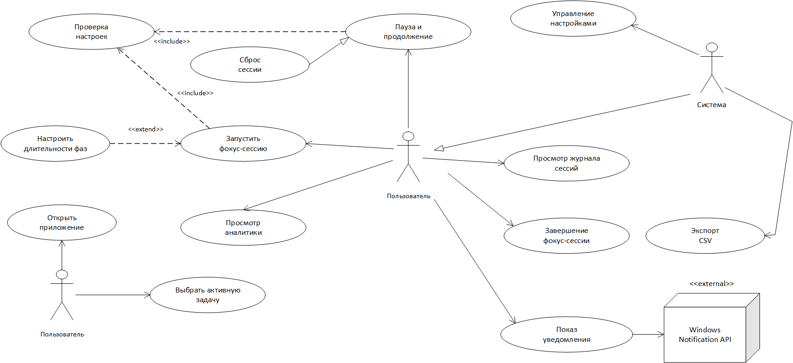
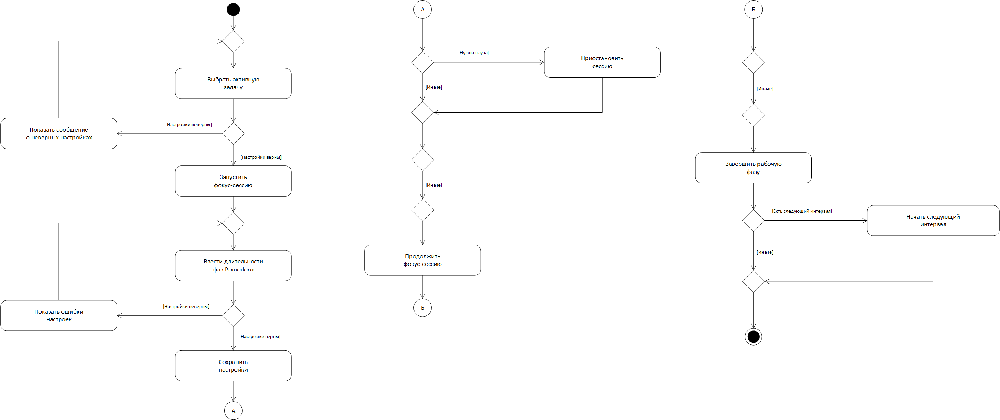
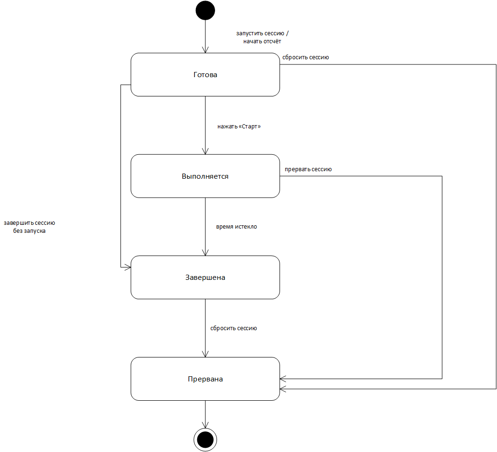
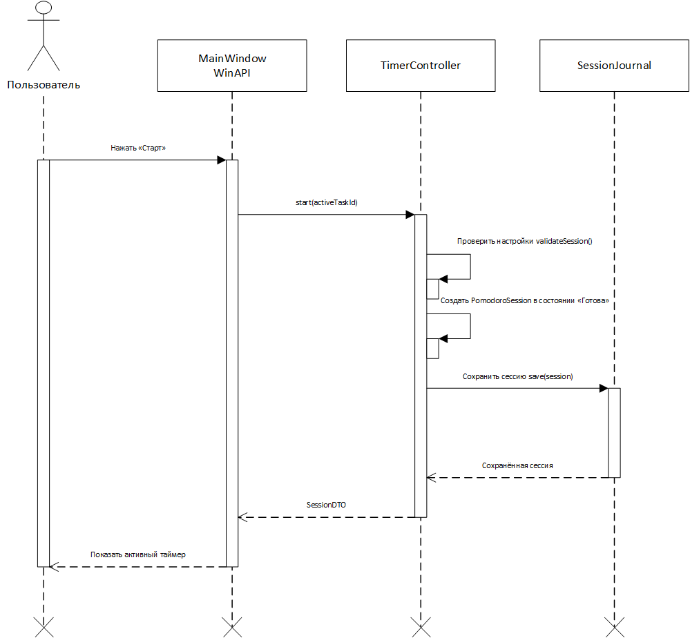

# Описание дизайна программного обеспечения (SDD)

Для проекта **Pomodoro-таймер с аналитикой**

Версия 0.3

Подготовил: **Серков И.М.**, группа 450502

БГУИР, кафедра ЭВМ

Дата изменения: 22.11.2026

## История изменений

| Name | Date | Reason For Changes | Version |
|---|---|---|---|
| Серков И.М. | 22.11.2026 | Добавлены UML-диаграммы динамического поведения и их описание | 0.3 |

---

## 1. Введение

### 1.1 Назначение документа

SDD описывает проектные решения и динамическое поведение Pomodoro-таймера с аналитикой.
Документ предназначен для разработчиков и архитекторов и используется вместе с SRS (`srs/srs.md`) при реализации и проверке сценариев.

### 1.2 Область применения

Система — нативное Windows-приложение на C++20/WinAPI для управления Pomodoro-таймером, локальными задачами, журналом сессий, аналитикой и экспортом CSV.

В текущей версии SDD описаны:

* модель вариантов использования;
* диаграмма деятельности выполнения фокус-сессии;
* диаграмма состояний объекта `PomodoroSession`;
* диаграмма последовательности завершения рабочей сессии.

### 1.3 Определения, акронимы и сокращения

| Term | Definition |
|---|---|
| UML | Unified Modeling Language — язык моделирования ПО |
| Use Case | Вариант использования (прецедент) |
| SDD | Software Design Description |
| SRS | Software Requirements Specification |
| ADR | Architectural Decision Record |
| PomodoroSession | Сущность текущей или зафиксированной фокус-сессии |
| CSV | Текстовый формат табличных данных с разделителями |

Полный глоссарий: `docs/glossary.md`.

### 1.4 Ссылки

| Документ | Расположение | Тип |
|---|---|---|
| SRS Pomodoro-таймера | `srs/srs.md` | нормативная |
| UML-диаграммы | `assets/uml/`, `assets/png/` | нормативная |
| Глоссарий | `docs/glossary.md` | нормативная |
| Дополнительные спецификации | `docs/supplementary-specs.md` | нормативная |
| ADR | `adr/0001-uml-dynamic-behavior.md` | нормативная |

### 1.5 Обзор документа

Раздел 2 описывает выбранные точки зрения. Раздел 3 содержит проектные представления с диаграммами. Раздел 4 фиксирует решения моделирования. Раздел 5 перечисляет приложения.

---

## 2. Обзор дизайна

### 2.1 Задачи стейкхолдеров

| Стейкхолдер | Задача | Как адресуется |
|---|---|---|
| Пользователь | Понятно управлять фокус-сессией и видеть собственную продуктивность | Use Case, Activity, State |
| Разработчик | Однозначно реализовать переходы фаз и запись журнала | State, Sequence, Activity |
| Заказчик | Проверять трассировку от требований к модели поведения | ID представлений и REQ |

### 2.2 Выбранные точки зрения

| Viewpoint | Назначение | Диаграмма |
|---|---|---|
| Context | Границы системы, актёры и прецеденты | Use Case |
| Algorithm | Порядок шагов фокус-сессии | Activity |
| State Dynamics | Жизненный цикл объекта `PomodoroSession` | State Machine |
| Interaction | Обмен сообщениями при завершении рабочей сессии | Sequence |

---

## 3. Проектные представления

### 3.1 VIEW-001 — модель вариантов использования

* **ID:** VIEW-001-use-case
* **Title:** Контекст и прецеденты Pomodoro-таймера
* **Viewpoint:** Context
* **SRS:** REQ-FUNC-001 — REQ-FUNC-009

Диаграмма показывает границу Pomodoro-таймера, актёров и функции базовой версии.

**Актёры:**

* **Пользователь** — основной актёр; запускает сессии, работает с задачами, журналом и аналитикой.
* **Windows** — внешняя ОС, предоставляющая уведомление о завершении фазы.

**Основные прецеденты:**

* управлять фокус-сессией: запуск, пауза, возобновление и сброс;
* выбрать активную задачу и управлять списком задач;
* просмотреть журнал и анализировать продуктивность;
* настроить цикл Pomodoro;
* экспортировать статистику в CSV.

Связь включения используется для обязательных действий запуска, паузы/возобновления, сброса и уведомления в сценарии управления сессией.

Исходная модель: `assets/uml/use-case.puml`; редактируемая схема Visio: `D:\test2\visio\Диаграмма вариантов использования.vsdx`.

### 3.2 VIEW-002 — выполнение фокус-сессии

* **ID:** VIEW-002-activity-session
* **Title:** Алгоритм выполнения фокус-сессии
* **Viewpoint:** Algorithm
* **SRS:** REQ-FUNC-001, REQ-FUNC-002, REQ-FUNC-003, REQ-FUNC-006, REQ-FUNC-012

Диаграмма деятельности описывает поток: выбор активной задачи, запуск отсчёта, проверку паузы и сброса, завершение работы, запись журнала, выбор короткого или длинного перерыва, уведомление и обновление аналитики.

Представление явно показывает альтернативные потоки паузы и сброса. Сброс активной рабочей фазы приводит к записи прерванной сессии, а нормальное истечение времени — к записи завершённой сессии.

Исходная модель: `assets/uml/activity-session.puml`; редактируемая схема Visio: `D:\test2\visio\Диаграмма деятельности.vsdx`.

### 3.3 VIEW-003 — жизненный цикл фокус-сессии

* **ID:** VIEW-003-session-state
* **Title:** Динамика состояний сущности `PomodoroSession`
* **Viewpoint:** State Dynamics
* **SRS:** REQ-FUNC-001, REQ-FUNC-006, REQ-FUNC-012

Состояния: «Готова», «Выполняется», «Приостановлена», «Завершена», «Прервана» и «Сброшена». Переходы задаются командами пользователя или истечением времени. Состояния «Завершена» и «Прервана» означают, что результат уже сохранён в журнале.

Модель состояний задаёт допустимые статусы сессии для реализации контроллера таймера и тестирования переходов.

Исходная модель: `assets/uml/session-state.puml`; редактируемая схема Visio: `D:\test2\visio\Диаграмма состояний.vsdx`.

### 3.4 VIEW-004 — завершение фокус-сессии

* **ID:** VIEW-004-sequence-complete-session
* **Title:** Взаимодействие при завершении рабочей сессии
* **Viewpoint:** Interaction
* **SRS:** REQ-FUNC-001, REQ-FUNC-002, REQ-FUNC-003, REQ-FUNC-007, REQ-FUNC-012

Участники: `Пользователь` — `Главное окно WinAPI` — `TimerController` — `SessionJournal` — `AnalyticsService` — `Windows Notification API`.

Основной поток: пользователь запускает сессию; контроллер запускает отсчёт и обновляет интерфейс. После истечения рабочего времени контроллер записывает завершённую сессию в журнал, инициирует пересчёт аналитики, вызывает уведомление Windows и обновляет экран следующей фазы.

Диаграмма фиксирует ответственность компонентов: UI не изменяет журнал напрямую, контроллер является оркестратором сценария, а аналитика строится только после успешной записи результата.

Исходная модель: `assets/uml/sequence-complete-session.puml`; редактируемая схема Visio: `D:\test2\visio\Диаграмма последовательности.vsdx`.

---

## 4. Решения

Детальное ADR: `adr/0001-uml-dynamic-behavior.md`.

| ID | Решение | Обоснование |
|---|---|---|
| DEC-UML-001 | Use Case с актёрами «Пользователь» и «Windows» | Достаточно для границы базовой версии без искусственных ролей |
| DEC-UML-002 | Activity для выполнения фокус-сессии | Показывает ветвления паузы, сброса и выбора перерыва |
| DEC-UML-003 | State machine для `PomodoroSession` | Нужна явная модель статусов для журнала и контроллера |
| DEC-UML-004 | Sequence для завершения сессии | Показывает порядок записи журнала, обновления аналитики и уведомления |

---

## 5. Приложения

| Файл | Содержание |
|---|---|
| `assets/uml/use-case.puml`, `assets/png/use-case.png` | Диаграмма вариантов использования |
| `assets/uml/activity-session.puml`, `assets/png/activity-session.png` | Диаграмма деятельности фокус-сессии |
| `assets/uml/session-state.puml`, `assets/png/session-state.png` | Диаграмма состояний фокус-сессии |
| `assets/uml/sequence-complete-session.puml`, `assets/png/sequence-complete-session.png` | Диаграмма последовательности |
| `docs/glossary.md` | Глоссарий проекта |
| `docs/supplementary-specs.md` | Дополнительные спецификации |
| `adr/0001-uml-dynamic-behavior.md` | ADR по моделированию динамического поведения |
