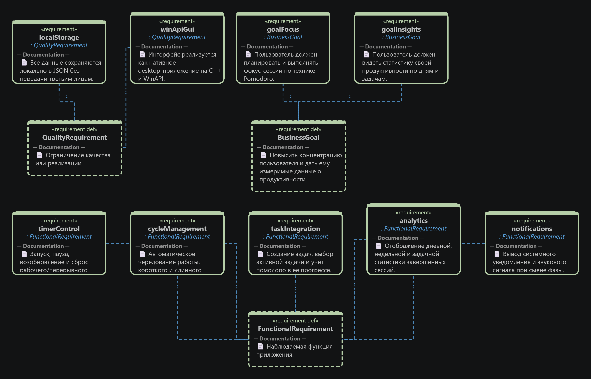
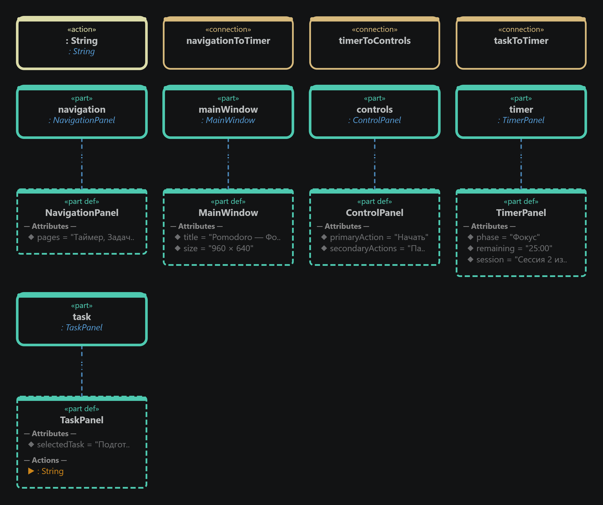
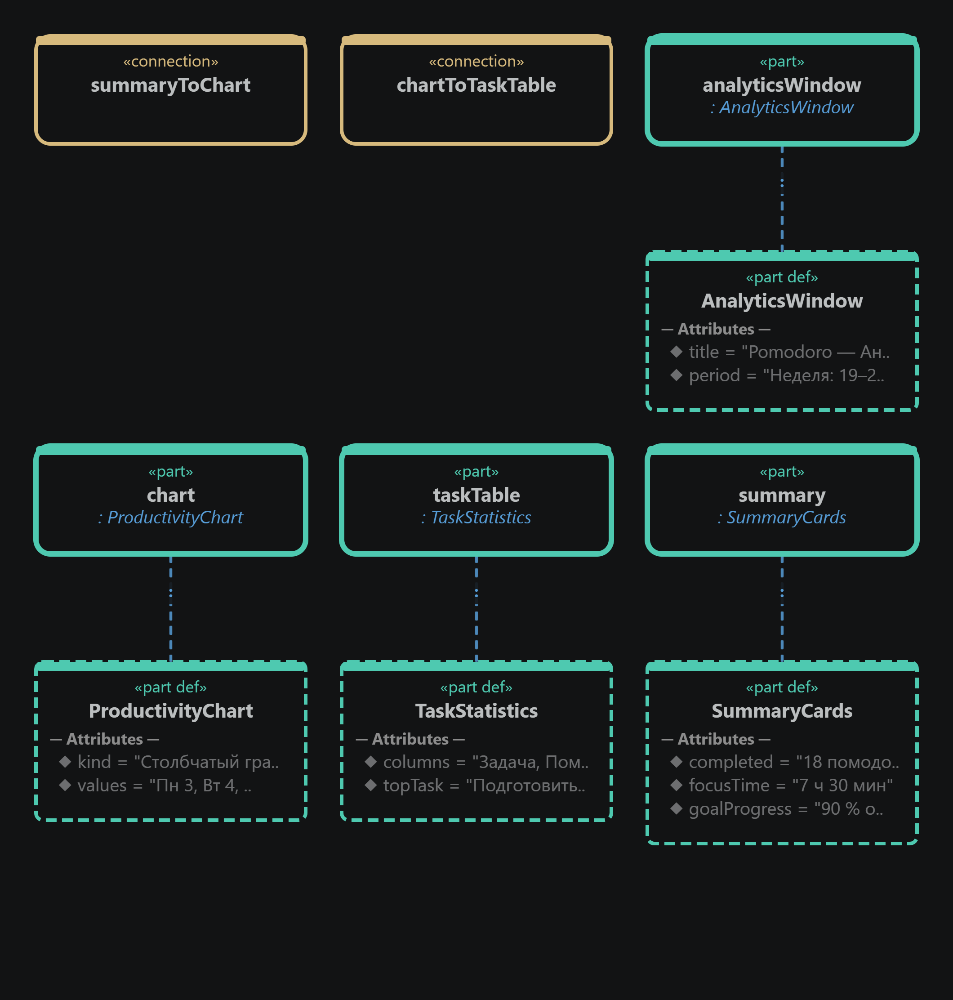

# Спецификация требований к ПО

Для «Pomodoro-таймер с аналитикой»

Версия 1.1

Подготовил И.М. Серков

БГУИР

26 октября 2026 г.

## Оглавление

* [1. Введение](#introduction)
  * [1.1 Назначение документа](#document-purpose)
  * [1.2 Область применения продукта](#product-scope)
  * [1.3 Определения, акронимы и сокращения](#definitions)
  * [1.4 Ссылки](#references)
  * [1.5 Обзор документа](#document-overview)
* [2. Обзор продукта](#product-overview)
  * [2.1 Перспектива продукта](#product-perspective)
  * [2.2 Функции продукта](#product-functions)
  * [2.3 Ограничения продукта](#product-constraints)
  * [2.4 Характеристики пользователей](#user-characteristics)
  * [2.5 Допущения и зависимости](#assumptions)
  * [2.6 Распределение требований](#apportioning)
* [3. Требования](#requirements)
  * [3.1 Внешние интерфейсы](#external-interfaces)
  * [3.2 Функциональные требования](#functional)
  * [3.3 Качество обслуживания](#quality)
  * [3.4 Соответствие стандартам](#compliance)
  * [3.5 Проектирование и реализация](#implementation)
  * [3.6 ИИ/МО](#aiml)
* [4. Верификация](#verification)
* [5. Приложения](#appendixes)

## История изменений

| Name | Date | Reason For Changes | Version |
|------|------|--------------------|---------|
| И.М. Серков | 25.10.2026 | Первоначальная разработка SRS, SysML v2-моделей и графической части | 1.0 |
| И.М. Серков | 26.10.2026 | Корректировка по замечаниям Заказчика: прогресс задач, учёт прерываний, экспорт CSV | 1.1 |

---

## 1. Введение

### 1.1 Назначение документа

Настоящий документ определяет требования к настольному приложению «Pomodoro-таймер с аналитикой». SRS предназначена для Заказчика, разработчика и тестировщика; она фиксирует, что должна делать система, и является основанием для согласования, реализации и проверки результата.

### 1.2 Область применения продукта

Продукт помогает пользователю организовать фокусированную работу по технике Pomodoro, связывать сессии с задачами и анализировать личную продуктивность. Целевая платформа — Windows; приложение реализуется на C++ с нативным интерфейсом WinAPI и локальным хранением данных.

Бизнес-цели продукта:

- **BR-1:** повысить концентрацию пользователя за счёт предсказуемого цикла работы и отдыха;
- **BR-2:** предоставить достоверную локальную статистику затраченного времени и завершённых сессий;
- **BR-3:** связать фокус-сессии с задачами и сделать ход выполнения задач измеримым;
- **BR-4:** дать возможность перенести статистику в CSV для дальнейшего анализа.

В первую версию входят таймер, задачи, журнал сессий, аналитика и экспорт CSV. Облачная синхронизация, совместная работа, внешние таск-трекеры и мобильная версия не входят в область проекта.

### 1.3 Определения, акронимы и сокращения

| Term | Definition |
|------|------------|
| Pomodoro | Рабочая фокус-сессия; по умолчанию длится 25 минут |
| Фаза | Работа, короткий либо длинный перерыв |
| Активная задача | Задача, которой назначается текущая фокус-сессия |
| CSV | Текстовый табличный формат, открываемый Microsoft Excel и LibreOffice Calc |
| GUI | Graphical User Interface — графический интерфейс пользователя |
| SRS | Software Requirements Specification — спецификация требований к ПО |
| WinAPI | Набор API Windows для разработки нативного интерфейса |

### 1.4 Ссылки

1. Шаблон SRS учебного репозитория, созданного в лабораторной работе №2.
2. Задание лабораторной работы №3 «Разработка и документирование бизнес-требований».
3. [SysML v2, OMG](https://www.omg.org/spec/SysML/2.0/) — язык моделирования графической части.
4. [Репозиторий проекта](https://github.com/cekmop-npu3/SDLC).

### 1.5 Обзор документа

Раздел 2 описывает продукт, его пользователей, ограничения и границы MVP. Раздел 3 содержит требования. Раздел 4 определяет методы их проверки. Раздел 5 содержит графические артефакты SysML v2 и порядок управления изменениями.

---

## 2. Обзор продукта

### 2.1 Перспектива продукта

Pomodoro-таймер является самостоятельным локальным desktop-приложением. Оно хранит задачи, настройки и историю на компьютере пользователя, не требует сети для основной работы и предоставляет информацию через главное окно, окно задач и окно аналитики.

### 2.2 Функции продукта

- Управление таймером: запуск, пауза, продолжение и сброс.
- Автоматическое чередование работы, короткого и длинного перерыва с уведомлениями.
- Создание задач, назначение активной задачи, планирование и отображение прогресса помодоро.
- История завершённых и прерванных сессий с причиной прерывания.
- Дневная, недельная и задачная аналитика с графиком продуктивности.
- Экспорт статистики выбранного периода в CSV.

### 2.3 Ограничения продукта

- Нативное desktop-приложение для 64-разрядных Windows 10/11.
- C++17/C++20, WinAPI и CMake.
- Локальное JSON-хранилище; передача данных внешним сервисам без действия пользователя не допускается.
- Облачная синхронизация, многопользовательский режим, внешние таск-трекеры и мобильная версия исключены из MVP.

### 2.4 Характеристики пользователей

- **Пользователь:** студент или специалист с базовыми навыками Windows, которому требуется организовать фокус-сессии и оценивать личную продуктивность.
- **Разработчик:** поддерживает C++/WinAPI-приложение, JSON-хранилище и документацию; отдельная административная панель не требуется.

### 2.5 Допущения и зависимости

- Пользователь работает на Windows 10 или Windows 11.
- Системные уведомления и звук доступны в настройках ОС; при их отключении смена фазы всё равно отображается в окне приложения.
- Удаление или ручное повреждение JSON-файла может привести к потере истории.
- CSV экспортируется локально и открывается выбранным пользователем табличным редактором.

### 2.6 Распределение требований

В MVP входят функции REQ-FUNC-001…011. Облачная синхронизация, календари третьих сторон, командная работа, мобильный клиент и автоматические рекомендации могут быть рассмотрены в следующих версиях.

---

## 3. Требования

### 3.1 Внешние интерфейсы

#### 3.1.1 Пользовательские интерфейсы

Главное окно содержит навигацию «Таймер», «Задачи», «Аналитика», «Настройки», таймер с текущей фазой, кнопки управления и активную задачу. Окно аналитики содержит карточки итогов, график по дням и таблицу задач. Интерфейс русскоязычный; основное действие таймера доступно не более чем за два действия мышью.

#### 3.1.2 Аппаратные интерфейсы

Специализированное оборудование не требуется. Используются стандартные клавиатура, мышь, дисплей и средства уведомлений Windows.

#### 3.1.3 Программные интерфейсы

- WinAPI для интерфейса и системных уведомлений Windows.
- Локальные JSON-файлы для задач, настроек и истории сессий.
- CSV-файл для экспорта статистики; формат должен открываться в Excel и LibreOffice Calc.

### 3.2 Функциональные требования

**REQ-FUNC-001: Управление таймером**

- **Statement:** Система должна запускать, приостанавливать, возобновлять и сбрасывать таймер текущей фазы без потери выбранной задачи.
- **Rationale:** Пользователь управляет фокус-сессией в соответствии с текущей рабочей ситуацией (BR-1).
- **Verification Method:** Demonstration, Test.

**REQ-FUNC-002: Цикл Pomodoro**

- **Statement:** Система должна поддерживать рабочую фазу, короткий и длинный перерыв; после окончания фазы должна предлагаться следующая фаза цикла.
- **Rationale:** Поддержание техники Pomodoro (BR-1).
- **Verification Method:** Demonstration, Test.

**REQ-FUNC-003: Уведомления**

- **Statement:** При завершении фазы система должна отображать системное уведомление и воспроизводить звуковой сигнал, если звук разрешён в ОС.
- **Rationale:** Пользователь не должен постоянно наблюдать за таймером (BR-1).
- **Verification Method:** Demonstration.

**REQ-FUNC-004: Управление задачами**

- **Statement:** Система должна позволять создавать, редактировать, завершать и удалять задачи; изменения должны сохраняться после перезапуска.
- **Rationale:** Задачи задают контекст фокус-сессий (BR-3).
- **Verification Method:** Test.

**REQ-FUNC-005: Активная задача и прогресс**

- **Statement:** Система должна позволять назначить активную задачу текущей сессии, задать плановое число помодоро и показывать прогресс в виде «выполнено / запланировано».
- **Rationale:** Пользователь понимает ход выполнения задачи и распределение времени (BR-3).
- **Verification Method:** Demonstration, Test.

**REQ-FUNC-006: Учёт прерванных сессий**

- **Statement:** Система должна фиксировать завершённые и прерванные сессии. При прерывании требуется подтверждение; пользователь может указать причину. Запись должна содержать дату, длительность, фазу, задачу, статус и при наличии причину.
- **Rationale:** Статистика должна отличать реальные завершения от отменённых сессий (BR-2).
- **Verification Method:** Test.

**REQ-FUNC-007: Сводная статистика**

- **Statement:** Система должна отображать статистику за день и неделю: число завершённых помодоро, время фокуса и выполнение дневной цели.
- **Rationale:** Пользователь получает измеримые данные о продуктивности (BR-2).
- **Verification Method:** Demonstration, Test.

**REQ-FUNC-008: График продуктивности**

- **Statement:** Система должна строить график количества завершённых помодоро по дням выбранного периода.
- **Rationale:** График помогает увидеть динамику продуктивности (BR-2).
- **Verification Method:** Demonstration, Test.

**REQ-FUNC-009: Статистика по задачам**

- **Statement:** Система должна показывать таблицу задач с числом сессий и временем фокуса по каждой задаче.
- **Rationale:** Пользователь оценивает, на какие задачи расходуется время (BR-3).
- **Verification Method:** Demonstration, Test.

**REQ-FUNC-010: Настройки цикла**

- **Statement:** Система должна позволять задать длительности рабочих и перерывных фаз, а также дневную цель; новые значения применяются к следующему запуску таймера.
- **Rationale:** Пользователь адаптирует технику под свой режим работы (BR-1).
- **Verification Method:** Test.

**REQ-FUNC-011: Экспорт CSV**

- **Statement:** Система должна экспортировать статистику за выбранный период в CSV. Файл содержит дату, задачу, статус сессии, число помодоро и время фокуса.
- **Rationale:** Данные могут быть открыты и проанализированы в Microsoft Excel или LibreOffice Calc (BR-4).
- **Verification Method:** Demonstration, Test.

### 3.3 Качество обслуживания

#### 3.3.1 Производительность

- **REQ-PERF-001:** Главное окно должно быть готово к работе не позднее чем через 2 секунды на Windows 10/11.

#### 3.3.2 Безопасность

- **REQ-SEC-001:** Данные пользователя должны храниться локально и не передаваться без явного действия пользователя.

#### 3.3.3 Надёжность

- **REQ-REL-001:** При штатном перезапуске приложения данные задач, настроек и истории не должны теряться.

#### 3.3.4 Доступность

- **REQ-AVAIL-001:** При недоступности системных уведомлений пользователь должен видеть смену фазы в окне приложения; сетевое соединение для основной работы не требуется.

#### 3.3.5 Наблюдаемость

- **REQ-OBS-001:** Система должна отображать статус текущей фазы, время до её завершения и сохранять информацию о завершённых и прерванных сессиях.

### 3.4 Соответствие стандартам

Документ оформлен по структуре учебного SRS-шаблона. Для графической части используется SysML v2. Исходный код должен соответствовать C++17/C++20 и требованиям WinAPI к Windows-приложениям.

### 3.5 Проектирование и реализация

#### 3.5.1 Установка

Поставляемая версия должна запускаться на 64-разрядной Windows 10/11. Инструкция сборки и запуска добавляется на этапе реализации.

#### 3.5.2 Сборка и поставка

Исходные материалы хранятся в Git; сборка выполняется CMake. Требования разрабатываются в ветке `requirements`, а их проверка выполняется через Pull Request.

#### 3.5.3 Распределение

В MVP распространение и обновление через внешний магазин приложений не предусматриваются.

#### 3.5.4 Сопровождаемость

Логика таймера, JSON-хранилище, задачи, аналитика, CSV-экспорт и WinAPI-интерфейс должны быть изолированы в отдельных модулях. При изменении требований сохраняются их идентификаторы и обновляется история документа.

### 3.6 ИИ/МО

ИИ и машинное обучение в текущем MVP не применяются. Автоматические рекомендации по продуктивности не входят в границы проекта.

---

## 4. Верификация

| Requirement ID | Verification Method | Сценарий проверки | Status | Evidence |
|----------------|---------------------|-------------------|--------|----------|
| REQ-FUNC-001 | Demonstration, Test | Запуск, пауза, продолжение и сброс таймера с назначенной задачей | Planned | — |
| REQ-FUNC-002–003 | Demonstration, Test | Проверить переходы фаз, уведомление и звук | Planned | — |
| REQ-FUNC-004–005 | Test | Создать задачу, задать план, завершить сессии и проверить прогресс | Planned | — |
| REQ-FUNC-006 | Test | Прервать сессию, подтвердить действие, указать причину и проверить запись истории | Planned | — |
| REQ-FUNC-007–009 | Demonstration, Test | Проверить итоги, график и таблицу задач за тестовый период | Planned | — |
| REQ-FUNC-010 | Test | Изменить длительности фаз и дневную цель, начать новую сессию | Planned | — |
| REQ-FUNC-011 | Demonstration, Test | Экспортировать период, открыть CSV в Excel/LibreOffice и сверить столбцы | Planned | — |
| REQ-PERF-001 | Test | Измерить время открытия главного окна | Planned | — |
| REQ-SEC-001, REQ-REL-001 | Test | Перезапустить приложение и проверить локальность и сохранность данных | Planned | — |

---

## 5. Приложения

Графическая часть подготовлена на SysML v2. Исходники моделей размещены в [sysml](sysml/), PNG-экспорты — в [gui](gui/).

1. Модель требований и трассируемости (рисунок 1) показывает бизнес-цели, функциональные и качественные требования.

*Рисунок 1 — Модель требований Pomodoro-таймера. [Исходник SysML v2](sysml/pomodoro_requirements.sysml).*

2. Прототип главного окна (рисунок 2) показывает навигацию, состояние фазы, оставшееся время, кнопки управления и активную задачу.

*Рисунок 2 — Прототип главного окна. [Исходник SysML v2](sysml/pomodoro_timer_ui.sysml).*

3. Прототип окна аналитики (рисунок 3) содержит карточки итогов, график завершённых помодоро и таблицу статистики задач.

*Рисунок 3 — Прототип окна аналитики. [Исходник SysML v2](sysml/pomodoro_analytics_ui.sysml).*

Изменения требований фиксируются коммитами в ветке `requirements` и обсуждаются в Pull Request. Принятые замечания отражаются в истории документа и модели требований.
